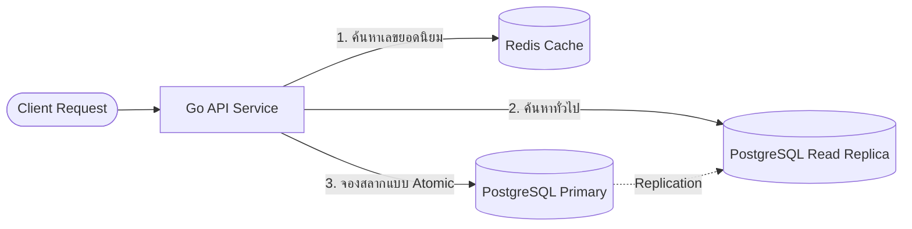

# Tech Stack — Lottery Search System

สรุปเทคโนโลยีที่ใช้ในระบบค้นหาและจัดสรรสลาก **10 ล้านใบ** รองรับผู้ใช้แย่งสลากพร้อมกันได้โดยไม่พัง ไม่ซับซ้อน

---

## 1. เทคโนโลยีที่เลือกใช้

| ส่วนประกอบ | เทคโนโลยี | หน้าที่ |
|---|---|---|
| **API Backend** | Go (Golang) | รับคำขอค้นหา/จองสลาก รองรับคำขอพร้อมกันนับหมื่น |
| **ฐานข้อมูลหลัก** | PostgreSQL 14+ | แหล่งข้อมูลจริง ควบคุมสต็อกและการจองสลาก (ACID) |
| **ดัชนีค้นหา** | B-Tree + Digit Indexes | ค้นหาตามช่วงเลขและตามตำแหน่งหลัก (p1–p6) |
| **แคช + ล็อค** | Redis | แคชเลขยอดนิยม (TTL 2–3s) + Rate Limit |
| **ควบคุม concurrency** | `FOR UPDATE SKIP LOCKED` | ล็อคสลากคนละใบพร้อมกัน ไม่ต้องรอคิว |
| **Background worker** | Go Worker (Ticker) | ทุก 5–10 วินาที คืนสลากที่จองค้างเกิน 5 นาที |
| **Monitoring** | Prometheus + Grafana | วัด Latency, Lock Wait Time, สถานะ DB |
| **Deployment** | Docker / Kubernetes | จัดการ Container + ขยาย Pods อัตโนมัติ (HPA) |

> **ทำไม Go + PostgreSQL?** — Go เด่นเรื่อง concurrency สูงและใช้แรมน้อย ส่วน PostgreSQL เด่นเรื่องความถูกต้องของข้อมูล (ACID) และมี `SKIP LOCKED` ในตัว

---

## 2. ภาพรวมสถาปัตยกรรม

แยกเส้นทาง **ค้นหา (Read)** กับ **จองสลาก (Write)** ออกจากกัน:

- **ค้นหา** → ผ่าน Redis หรือ Read Replica (ไม่ล็อคตาราง เร็ว ไม่หน่วง)
- **จองสลาก** → ตรงเข้า Primary ใน Transaction แล้วล็อคแถวสลากทันที

---

## 3. PostgreSQL หรือ Redis เลือกใช้ยังไง?

### 3.1 PostgreSQL — คลังข้อมูลหลัก (Source of Truth)
- **ACID ครบถ้วน**: ข้อมูลการจองสลากห้ามผิดพลาดหรือสูญหาย
- **`SKIP LOCKED`**: ถ้าคนแย่งจองเลขเดียวกัน ให้ข้ามแถวที่ติดล็อคไปหยิบใบถัดไป **ไม่มี Deadlock ไม่ต้องรอคิว**
- **ข้อมูลแค่ ~2GB**: 10 ล้านใบรวม Index อยู่ใน RAM ของ server มาตรฐานได้ทั้งหมด → Query ระดับมิลลิวินาที

### 3.2 Redis — ชั้นความเร็วเสริม
- **แคชเลขยอดนิยม**: ลดโหลด DB ตอนคนค้นหาเลขเดียวกันพร้อมกันจำนวนมาก
- **Rate Limit**: ป้องกันสแปมค้นหา
- **ข้อควรระวัง**: ไม่ใช้เก็บสต็อกสลากถาวร เพราะข้อมูลอาจหายได้ถ้าระบบล่ม

| หัวข้อ | PostgreSQL | Redis |
|---|:---:|:---:|
| **บทบาท** | เก็บข้อมูลจริง + ตัดสต็อกจอง | แคชผลค้นหา + ป้องกันโหลดสูง |
| **ความปลอดภัยของข้อมูล** | สูงสุด (อยู่บน Disk) | เน้นความเร็ว (In-Memory) |
| **Concurrency** | `SKIP LOCKED` ระดับแถว | Distributed Lock / Atomic Counter |

---

## 4. เอกสารที่เกี่ยวข้อง

- 🗄️ [SQL Scripts — วิธีรันสคริปต์สร้างตาราง](./sql_script/README.md)
- 🧭 [Sequence Flow — ขั้นตอนเมื่อผู้ใช้แย่งสลากใบเดียวกัน](../sequence_diagram/flow.md)
- 📐 [Schema — โครงสร้างตารางทั้ง 5 ตาราง](./schema/table_5.png)
- 📊 [ER Diagram — ความสัมพันธ์ของตาราง](./er_diagram/er_5.png)