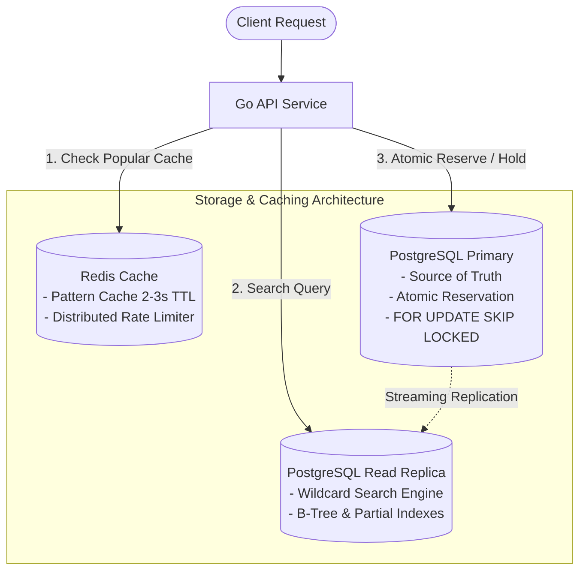

# Tech Stack & Database Architecture — Lottery Search System

เอกสารสรุปรายการเทคโนโลยีที่เลือกใช้ (Technology Stack) และการออกแบบสถาปัตยกรรมฐานข้อมูลสำหรับระบบ **Lottery Search System** ซึ่งออกแบบมาเพื่อรองรับข้อมูลสลาก 10 ล้านใบ (10M Records) พร้อมระบบค้นหาแบบ Wildcard และการจัดสรรสลากที่ไม่ซ้ำซ้อนในระดับ High Concurrency

---

## 1. Technology Stack Overview

> **Go + PostgreSQL** เป็นคู่ผสมผสาน (Combination) ที่มีประสิทธิภาพสูงสุดสำหรับเวิร์กลักษณะนี้ เนื่องจากให้ทั้งความเร็วในการประมวลผล (High Throughput / Low Latency) และความถูกต้องแม่นยำของข้อมูลในระดับธุรกรรม (ACID Transactions)

| องค์ประกอบ (Component) | เทคโนโลยีที่เลือก (Technology) | บทบาทหน้าที่และเหตุผลในการเลือกใช้ (Rationale) |
|---|---|---|
| **API Service** | **Go (Golang)** | รองรับ Concurrency สูงด้วย Goroutines ประหยัด Memory และ Latency ต่ำมาก |
| **Primary Database** | **PostgreSQL 16+** | เป็น Single Source of Truth สำหรับข้อมูลสลากและธุรกรรมการจอง (ACID Guarantees) |
| **Search Index** | **PostgreSQL B-Tree / Digit Indexes** | ใช้ B-Tree Range Scans และ Partial Indexes ค้นหาตัวเลขแบบ Prefix/Suffix/Digit |
| **Advanced Search** | **Roaring Bitmaps** *(Optional/Benchmark)* | ใช้อัลกอริทึม Bitwise AND ใน Memory หากต้องการ Latency ระดับ Sub-millisecond |
| **Cache & Rate Limit** | **Redis** | แคชผลลัพธ์ของ Search Pattern ยอดนิยม (Short TTL) และคุม Rate Limiting |
| **Reservation Engine** | **PostgreSQL Transaction** | จัดการจองสลากแบบ Atomic เพื่อการันตีว่าไม่มีการตัดสต็อกเกิน (No Overbooking) |
| **Concurrency Control** | **`FOR UPDATE SKIP LOCKED`** | ป้องกันการแย่งสลากใบเดียวกันแบบ Non-blocking ไม่เกิด Deadlock และไม่ต้องรอคิว |
| **Background Worker** | **Go Worker (Goroutines / Ticker)** | ทำงานเบื้องหลังทุก 5-10 วินาที เพื่อคืนสลากที่หมดเวลาจอง (Expires) สู่สถานะว่าง |
| **Monitoring** | **Prometheus + Grafana** | ติดตาม Metrics สำคัญ เช่น Lock Wait Time, Query P99 Latency, และ Cache Hit Ratio |
| **Logging** | **Structured Logging (`slog`)** | บันทึก Log รูปแบบ JSON แบบรวมศูนย์ เพื่อความสะดวกในการทำ Log Analytics และ Audit |
| **Deployment** | **Kubernetes / AWS ECS / Docker** | รองรับการทำ Horizontal Pod Autoscaling (HPA) ตามปริมาณทราฟฟิก |

---

## 2. การวิเคราะห์เปรียบเทียบฐานข้อมูล: PostgreSQL vs Redis

---

### 2.1 ทำไมต้องเลือก PostgreSQL เป็น Primary Database?

PostgreSQL มีความเหมาะสมสูงสุดในการเป็น **Single Source of Truth** สำหรับระบบนี้ ด้วยเหตุผลดังต่อไปนี้:

1. **ACID Transaction & Data Integrity**:
   - การจองและตัดจำหน่ายสลากเป็นธุรกรรมสำคัญทางธุรกิจ (Business-Critical State) ห้ามเกิดข้อผิดพลาดหรือข้อมูลสูญหายโดยเด็ดขาด
2. **Row-Level Locking แบบ `SKIP LOCKED`**:
   - รองรับ `SELECT ... FOR UPDATE SKIP LOCKED` ซึ่งเป็นหัวใจสำคัญของการแจกสลากแบบ Non-blocking ช่วยให้ผู้ใช้หลายคนที่ค้นหา Pattern เดียวกัน ได้รับสลากคนละใบพร้อมกันทันทีโดยไม่ต้องรอคิว
3. **ประสิทธิภาพบนชุดข้อมูล 10 ล้านแถว (Dataset Scale)**:
   - ตารางสลาก 10 ล้านแถวและดัชนี มีขนาดข้อมูลรวมประมาณ **~2.0 GB**
   - สามารถเก็บไว้ในหน่วยความจำ RAM (**Shared Buffers**) ของ Database Server ขนาดมาตรฐาน (16GB - 32GB) ได้ทั้งหมด ทำให้ Query เกือบ 100% รันบน Memory ด้วยความเร็วสูง
4. **ความยืดหยุ่นในการสร้าง Index**:
   - รองรับทั้ง B-Tree, Functional Indexes, Partial Indexes (`WHERE status = 'AVAILABLE'`)
5. **ความพร้อมระดับ Production (Operational Maturity)**:
   - รองรับ Streaming Replication ทำ Read Replicas แยกโหลดค้นหาออกจากโหนดเขียนหลัก
   - มีระบบ Point-In-Time Recovery (PITR) และเครื่องมือ Backup ระดับ Enterprise

---

### 2.2 บทบาทที่เหมาะสมของ Redis (และทำไมจึงไม่ควรใช้เป็น Primary Inventory)

#### บทบาทที่แนะนำสำหรับ Redis:
- **Search Result Cache**: แคชผลการค้นหาสำหรับ Pattern ยอดนิยม (เช่น เลขดังท้ายสองตัว `****99`) โดยตั้ง TTL สั้นๆ 2-3 วินาที เพื่อลดภาระของ Read Replica
- **Distributed Rate Limiting**: ป้องกันการยิงค้นหาถี่ผิดปกติด้วย Token Bucket / Leaky Bucket
- **Temporary Session / Lock**: สามารถนำมาทำ Distributed Lock ระดับ Pattern ได้ (หากเลือกใช้สถาปัตยกรรมแบบ Serialized Queue)

#### ข้อจำกัดของ Redis ในฐานะ Primary Store ของระบบนี้:
> [!WARNING]  
> **ไม่ควรใช้ Redis เป็น Source of Truth ของข้อมูลสต็อกสลาก (Ticket Inventory)** เนื่องจาก:
> - **Durability & Persistence Risk**: แม้จะมี RDB/AOF แต่ยังมีความเสี่ยงข้อมูลสูญหายระหว่างรอ fsync หากระบบขัดข้อง
> - **Overhead ด้านหน่วยความจำ**: การเก็บโครงสร้างข้อมูลสลาก 10M ใบและดัชนีค้นหาบน Memory ตลอดเวลาสิ้นเปลือง RAM สูงเกินความจำเป็น
> - **ขาด Transactional Relational Support**: การตรวจสอบ Foreign Key, Consistency ข้ามตาราง และการจัดการประวัติการจัดสรร (Allocations) ทำได้ยากและเสี่ยงต่อ Data Inconsistency

---

### 2.3 ตารางสรุปการประเมินเทคโนโลยี (Database Comparison Matrix)

| ปัจจัยการพิจารณา | PostgreSQL 16+ *(Primary)* | Redis 7+ *(Cache/Lock)* | Elasticsearch *(Alternative)* |
|---|:---:|:---:|:---:|
| **ความถูกต้องของข้อมูล (Consistency)** | **Strong Consistency (ACID)** | Eventual / In-memory | Eventual Consistency (1s delay) |
| **กลไกการล็อค (Concurrency Lock)** | **Row-level `SKIP LOCKED`** | Redis SETNX / Redlock | ไม่มี Row-level lock สำหรับจอง |
| **ความเร็วในการค้นหา (Query Latency)** | **1 - 15 ms** (Indexed In-RAM) | **< 1 ms** (Memory) | **5 - 20 ms** (Inverted Index) |
| **ขนาดการใช้หน่วยความจำ (RAM)** | ปานกลาง (~2GB Cached in RAM) | สูงมาก (In-Memory 100%) | สูงมาก (JVM Heap + OS Cache) |
| **ความซับซ้อนในการดูแล (Ops Complexity)** | **ต่ำ - ปานกลาง** | ต่ำ | สูง (Cluster, Shards, Rebalance) |
| **ความเหมาะสมกับระบบนี้** | **Primary Database (แนะนำ)** | **Auxiliary Cache (แนะนำ)** | **ไม่จำเป็นสำหรับตัวเลข 6 หลัก** |

---

## 3. Architecture Diagram, Sequence & Database Schema

ภาพรวมสถาปัตยกรรมการทำงาน ลำดับการจัดสรรสลากพร้อมกัน (Sequence Diagram) และโครงสร้างฐานข้อมูลเชิงสัมพันธ์:

### เอกสารและไฟล์ที่เกี่ยวข้อง (Related Resources):
- 📘 **[Flow & Concurrency Architecture](../flow.md)**: คำอธิบายขั้นตอนการทำงานและ Sequence Flow ฉบับละเอียด
- 🗄️ **[SQL DDL Scripts](./sql_script/README.md)**: สคริปต์ SQL แยกรายตาราง (`users`, `tickets`, `patterns`, `allocations`, `pattern_index`)
- 📐 **[Schema Image Reference](./schema/table_5.png)**: แผนผังโครงสร้างตารางข้อมูล
- 📊 **[ER Diagram Reference](./er_diagram/er_5.png)**: แผนผังความสัมพันธ์ระหว่าง Entity
