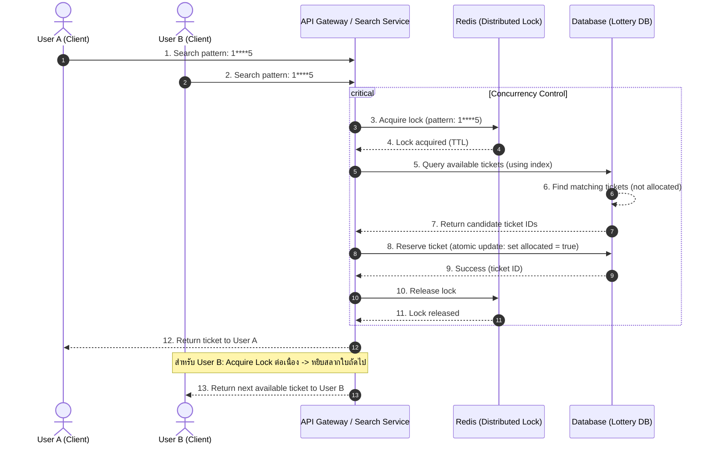
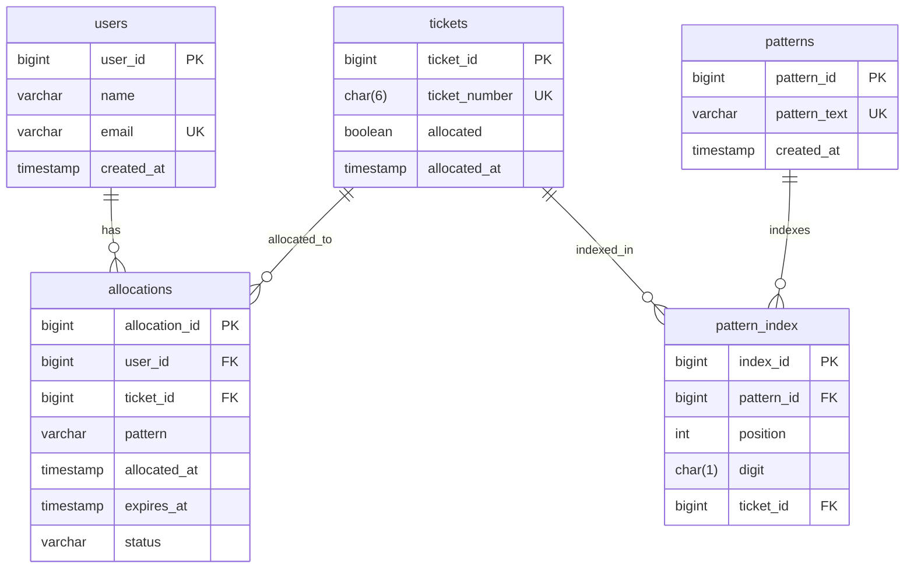

# Lottery Search System

Technology Stack
Component	Technology
API	Go
Primary DB	PostgreSQL
Search Index	PostgreSQL B-tree / digit indexes
Advanced Search	Bitmap / specialized index if benchmark requires
Cache	Redis
Reservation	PostgreSQL transaction
Locking	PostgreSQL row-level lock
Concurrency	SKIP LOCKED
Background Worker	Go Worker
Monitoring	Prometheus + Grafana
Logs	Centralized logging
Deployment	Kubernetes / ECS / VM ตาม infrastructure

Go + PostgreSQL เป็น combination ที่เหมาะกับ workload นี้


-- -----------------------------------------------------

1. Production Architecture

```text
                         ┌─────────────┐
                         │   Client    │
                         └──────┬──────┘
                                │
                                ▼
                         ┌─────────────┐
                         │ API Gateway │
                         └──────┬──────┘
                                │
                                ▼
                     ┌────────────────────┐
                     │ Lottery Search API │
                     │        Go          │
                     └─────────┬──────────┘
                               │
                  ┌────────────┴────────────┐
                  │                         │
                  ▼                         ▼
           Search / Candidate          Reservation
                  │                         │
                  ▼                         ▼
          PostgreSQL Replica          PostgreSQL Primary
                  │                         │
                  │                  ┌──────┴──────┐
                  │                  │ Reservation │
                  │                  │    Table    │
                  │                  └─────────────┘
                  │
                  ▼
                Redis
           (Cache & Lock)
```

หาก traffic สูงมาก (Horizontal Scaling):

```text
                  ┌───────────────┐
                  │ Load Balancer │
                  └───────┬───────┘
                          │
              ┌───────────┼───────────┐
              ▼           ▼           ▼
           Search       Search      Search
           Service      Service      Service
              │           │           │
              └───────────┼───────────┘
                          │
                          ▼
                PostgreSQL Cluster / Redis
```

---

### 1.1 Sequence Diagram — Concurrent Allocation

ลำดับการทำงานเมื่อมีผู้ใช้ 2 คน (User A และ User B) ส่งคำขอค้นหา/จองสลากด้วย Pattern เดียวกัน (`1****5`) เข้ามาพร้อมกัน:



#### เปรียบเทียบ 2 กลยุทธ์การล็อค (Locking Strategies Comparison):

| คุณสมบัติ | วิธีที่ 1: Redis Distributed Lock (ตามไดอะแกรมข้างต้น) | วิธีที่ 2: PostgreSQL `FOR UPDATE SKIP LOCKED` (แนะนำใน Production) |
|---|---|---|
| **กลไก** | ล็อคระดับ Pattern Key บน Redis ชั่วคราวด้วย TTL | ล็อคระดับ Row ของ Ticket ที่ตรงกับเงื่อนไขใน Database ทันที |
| **พฤติกรรมของ User B** | ต้องรอให้ User A ปล่อย Lock ก่อน จึงจะเข้าถึงการจองได้ (Serialized Queue) | **ไม่ต้องรอคิว (Non-blocking)** ระบบจะข้ามแถวที่ User A ล็อคอยู่ไปหยิบใบถัดไปทันที |
| **Overhead** | มี Network Roundtrip ไป Redis (Acquire + Release) | รวมอยู่ใน Database Transaction เดียวแบบ Atomic |
| **Failure Safety** | เสี่ยงค้างถ้าลืม Release หรือ TTL หลุดก่อนเวลา | ปลอดภัย 100% ถ้า Worker ตาย DB ทำ Rollback อัตโนมัติ |

---

### 1.2 ER Diagram



---

### 1.3 Database Schema (Relational)

#### 1. ตาราง `users`
| Column | Type | Constraints | Description |
|---|---|---|---|
| `user_id` | `BIGINT` | `PK` | รหัสประจำตัวผู้ใช้ |
| `name` | `VARCHAR(100)` | `NOT NULL` | ชื่อผู้ใช้ |
| `email` | `VARCHAR(100)` | `UNIQUE, NOT NULL` | อีเมลผู้ใช้ |
| `created_at` | `TIMESTAMP` | `DEFAULT CURRENT_TIMESTAMP` | เวลาที่สร้าง |

#### 2. ตาราง `tickets`
| Column | Type | Constraints | Description |
|---|---|---|---|
| `ticket_id` | `BIGINT` | `PK` | รหัสสลาก (1 - 10,000,000) |
| `ticket_number` | `CHAR(6)` | `NOT NULL` | เลขสลาก 6 หลัก (เช่น `123456`) |
| `allocated` | `BOOLEAN` | `DEFAULT FALSE` | สถานะการถูกจัดสรร/จอง |
| `allocated_at` | `TIMESTAMP` | `NULL` | เวลาที่ถูกจัดสรร |

#### 3. ตาราง `allocations`
| Column | Type | Constraints | Description |
|---|---|---|---|
| `allocation_id` | `BIGINT` | `PK` | รหัสรายการจัดสรร |
| `user_id` | `BIGINT` | `FK -> users(user_id)` | รหัสผู้ใช้ |
| `ticket_id` | `BIGINT` | `FK -> tickets(ticket_id)` | รหัสสลากที่ได้รับ |
| `pattern` | `VARCHAR(6)` | `NOT NULL` | Pattern ที่ใช้ค้นหา (เช่น `1****5`) |
| `allocated_at` | `TIMESTAMP` | `DEFAULT CURRENT_TIMESTAMP` | เวลาจัดสรร |
| `expires_at` | `TIMESTAMP` | `NOT NULL` | เวลาหมดอายุการจอง |
| `status` | `VARCHAR(20)` | `DEFAULT 'ACTIVE'` | สถานะ (`ACTIVE`, `EXPIRED`, `SOLD`) |

#### 4. ตาราง `patterns`
| Column | Type | Constraints | Description |
|---|---|---|---|
| `pattern_id` | `BIGINT` | `PK` | รหัส Pattern |
| `pattern_text` | `VARCHAR(6)` | `UNIQUE, NOT NULL` | ข้อความ Pattern (เช่น `1****5`, `****23`) |
| `created_at` | `TIMESTAMP` | `DEFAULT CURRENT_TIMESTAMP` | เวลาที่บันทึก Pattern |

#### 5. ตาราง `pattern_index`
| Column | Type | Constraints | Description |
|---|---|---|---|
| `index_id` | `BIGINT` | `PK` | รหัสดัชนี |
| `pattern_id` | `BIGINT` | `FK -> patterns(pattern_id)` | รหัส Pattern |
| `position` | `INT` | `NOT NULL` | ตำแหน่งของตัวเลข (1 - 6) |
| `digit` | `CHAR(1)` | `NULLABLE` | ตัวเลขในตำแหน่งนั้น (0 - 9 หรือ NULL) |
| `ticket_id` | `BIGINT` | `FK -> tickets(ticket_id)` | รหัสสลากที่ตรงเงื่อนไข |

#### Recommended Indexes & Constraints:
- `INDEX tickets_alloc_num ON tickets(allocated, ticket_number)`
- `INDEX idx_pattern_pos_digit ON pattern_index(pattern_id, position, digit)`
- `INDEX idx_alloc_user_time ON allocations(user_id, allocated_at)`
- `INDEX idx_patterns_text ON patterns(pattern_text)`
- `CONSTRAINT uq_pattern_index UNIQUE(pattern_id, position, digit, ticket_id)`

> **💡 Architectural Note (วิวัฒนาการในการออกแบบระดับ Production)**:  
> การใช้ตาราง `pattern_index` ล่วงหน้า เหมาะสำหรับการ Query ที่มี Pattern คงที่และจำกัด แต่หากผู้ใช้ค้นหา Pattern แบบ Dynamic หลากหลายรูปแบบ การเก็บ `p1..p6` แยกเป็นคอลัมน์ในตาราง `tickets` และสร้าง Functional / Composite B-Tree Index จะช่วยประหยัดพื้นที่จัดเก็บและลดความซับซ้อนในการทำ Maintenance ดัชนีในระยะยาวได้อย่างมหาศาล


2.API Concept

API สามารถออกแบบในลักษณะ:

POST /lottery/search

request:

pattern = "123***"
quantity = 1

ระบบไม่ได้เพียง return candidate tickets แต่ทำ:

find
→ lock
→ reserve
→ return

ผลลัพธ์:

reservation_id
ticket_id
lottery_number
expires_at


-- -----------------------------------------------------


3.Handling High Traffic

สมมติ:

10M tickets
100 requests/sec

ถือว่า PostgreSQL สามารถรองรับได้ หาก query/index ถูกออกแบบดี

แต่ถ้ากลายเป็น:

10,000+ requests/sec

ควรเพิ่ม architecture:

                 API
                  │
                  ▼
             Search Service
                  │
          ┌───────┴───────┐
          ▼               ▼
      Search Cache      PostgreSQL
          │               │
          │               ▼
          │          Allocation
          │             DB
          │
          ▼
       Redis

Redis ใช้ cache candidate information ได้ แต่ transaction ที่ reserve ticket ต้องยังคงอยู่ใน durable database


-- -----------------------------------------------------

4.Failure Handling

สมมติ application server ตายหลัง reserve:

BEGIN
 ↓
LOCK
 ↓
RESERVE
 ↓
Application crashes

ถ้า transaction ยังไม่ commit:

→ PostgreSQL rollback
→ lock released

ถ้า commit แล้ว:

→ reservation อยู่
→ expires_at จัดการต่อ

นี่เป็นข้อดีของการใช้ database transaction เป็น source of truth


-- -----------------------------------------------------

5.Database Performance Analysis
CPU
IOPS
connection pool
lock wait
deadlock
index hit ratio
replication lag

โดยเฉพาะ:

lock wait time

สำคัญมากสำหรับระบบ allocation


-- -----------------------------------------------------

6.Search Strategy

ผมแนะนำให้มี query planner ภายใน Search Service:

Pattern
   │
   ▼
Analyze fixed positions
   │
   ├── 6 fixed → Exact Lookup
   │
   ├── Prefix → Range Index
   │
   ├── Several fixed positions → Digit Index
   │
   └── Very low selectivity → Bitmap / Candidate Pool

ไม่ควรใช้ algorithm เดียวกับทุก pattern


-- -----------------------------------------------------

7. Allocation Algorithm

Logical flow:

1. Validate pattern
2. Parse wildcard pattern
3. Determine search strategy
4. Find candidate tickets
5. Start transaction
6. Lock candidate tickets
7. Skip tickets already reserved
8. Select required number
9. Create reservation records
10. Commit
11. Return allocated tickets

ถ้า candidate ถูก lock อยู่:

SKIP LOCKED

เพื่อให้ request อื่นไปเลือก ticket ตัวถัดไป


