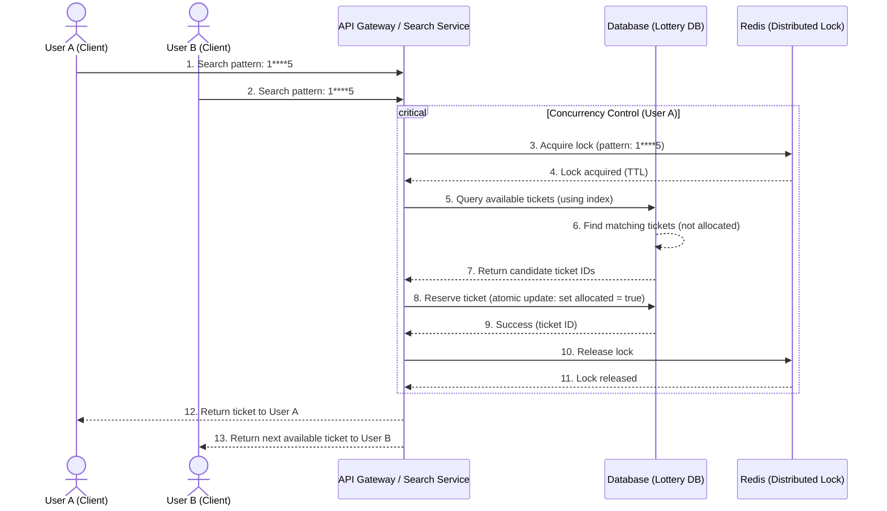
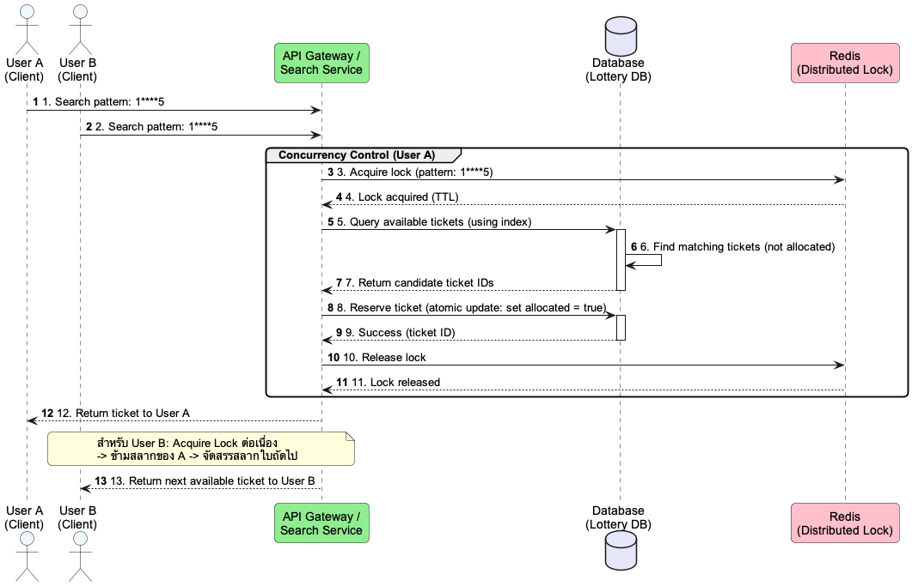
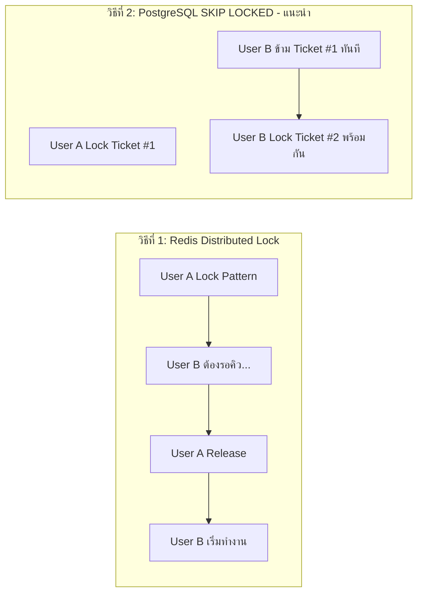
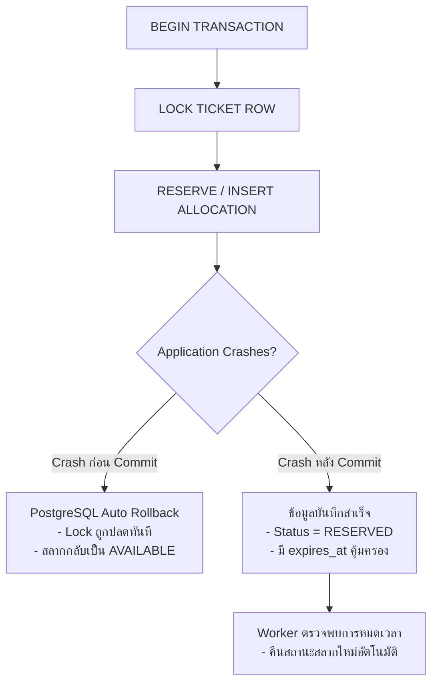

# Architecture & Sequence Flow — Lottery Search System

เอกสารสรุปภาพรวมสถาปัตยกรรมระบบ (System Architecture), ลำดับขั้นตอนการทำงาน (Sequence Flow), และอัลกอริทึมในการค้นหาและจัดสรรสลากกินแบ่งรัฐบาล (10 ล้านรายการ) ในสภาวะ Concurrency สูง

---

## 1. Technology Stack Overview

> **Go + PostgreSQL** คือสถาปัตยกรรมหลักที่ออกแบบมาเพื่อรองรับงานประเภท High Throughput / Low Latency พร้อมการันตีความถูกต้องของข้อมูลในระดับธุรกรรม (ACID Transactions)

| ส่วนประกอบ (Component) | เทคโนโลยี (Technology) | บทบาทหน้าที่ (Role & Responsibility) |
|---|---|---|
| **API Service** | **Go (Golang)** | ประมวลผลรวดเร็ว จัดการ Concurrent Requests ได้มหาศาลด้วย Goroutines |
| **Primary Database** | **PostgreSQL** | เป็น Single Source of Truth สำหรับสต็อกสลากและการทำธุรกรรมจอง (ACID) |
| **Search Index** | **B-Tree / Digit Indexes** | ทำ Range Scan และดัชนีแยกตามตำแหน่งตัวเลขเพื่อค้นหาแบบ Wildcard |
| **Advanced Search** | **Roaring Bitmaps** *(Optional)* | อัลกอริทึม Bitwise AND ใน Memory หากต้องการ Latency ระดับ Sub-millisecond |
| **Cache & Lock** | **Redis** | แคชผลลัพธ์ของ Pattern ยอดนิยม (Short TTL) และควบคุม Rate Limiting |
| **Reservation Engine**| **PostgreSQL Transaction** | จัดการจองสลากแบบ Atomic รับประกันว่าไม่มีการตัดสต็อกเกิน (No Overbooking) |
| **Concurrency Lock** | **`FOR UPDATE SKIP LOCKED`** | ป้องกันการแย่งสลากใบเดียวกันแบบ Non-blocking (ไม่ต้องรอคิว) |
| **Background Worker**| **Go Worker (Ticker)** | รันเบื้องหลังทุก 5-10 วินาที คืนสลากที่หมดเวลาจอง (Expired Hold) กลับสู่ระบบ |
| **Monitoring** | **Prometheus + Grafana** | ตรวจจับค่า Latency, Lock Wait Time, และ Database Connection Pool |
| **Logging** | **Centralized Structured Log** | บันทึก Log รูปแบบ JSON ตรวจสอบย้อนหลังได้ง่าย |
| **Deployment** | **Kubernetes / ECS / Docker** | รองรับการทำ Horizontal Pod Autoscaling (HPA) ตามปริมาณงาน |

---

## 2. Production Architecture

### 2.1 สถาปัตยกรรมพื้นฐาน (Standard Architecture)
แยกโหลดการทำงานระหว่างการค้นหา (Read-heavy) และการจองสลาก (Transactional Write) อย่างชัดเจน:

```text
                         ┌─────────────┐
                         │   Client    │
                         └──────┬──────┘
                                │
                                ▼
                         ┌─────────────┐
                         │ API Gateway │
                         └──────┬──────┘
                                │
                                ▼
                     ┌────────────────────┐
                     │ Lottery Search API │
                     │        Go          │
                     └─────────┬──────────┘
                               │
                  ┌────────────┴────────────┐
                  │                         │
                  ▼                         ▼
           Search / Candidate          Reservation
                  │                         │
                  ▼                         ▼
          PostgreSQL Replica          PostgreSQL Primary
             (Read-Only)               (Read / Write)
                  │                         │
                  │                  ┌──────┴──────┐
                  │                  │ Allocations │
                  │                  │    Table    │
                  │                  └─────────────┘
                  │
                  ▼
                Redis
            (Cache & Lock)
```

---

### 2.2 สถาปัตยกรรมรองรับทราฟฟิกมหาศาล (Horizontal Scaling 10,000+ req/s)

เมื่อมีปริมาณคำขอเพิ่มขึ้น สามารถขยายระบบในแนวนอน (Scale Out) ได้อย่างอิสระ:

```text
                  ┌───────────────┐
                  │ Load Balancer │
                  └───────┬───────┘
                          │
              ┌───────────┼───────────┐
              ▼           ▼           ▼
        Search Service  Search Service  Search Service
           (Go Pod)        (Go Pod)        (Go Pod)
              │               │               │
              └───────────────┼───────────────┘
                              │
                    ┌─────────┴─────────┐
                    ▼                   ▼
               Redis Cache      PostgreSQL Cluster
             (Short TTL 2-3s)   (Primary + Replicas)
```

---

## 3. Sequence Diagram — Concurrent Allocation Flow

ลำดับการทำงานเมื่อมีผู้ใช้ 2 คน (**User A** และ **User B**) ส่งคำขอค้นหา/จองสลากด้วย Pattern เดียวกัน (`1****5`) เข้ามาในเวลาพร้อมกัน:






### 💡 การเปรียบเทียบกลยุทธ์การล็อค (Locking Strategies):



- **วิธีที่ 1 (Redis Lock)**: ล็อคระดับ Pattern ทำให้เกิดคิวรอ (Serialized) เหมาะกับระบบที่ต้องการจำกัดโควตาต่อ Pattern
- **วิธีที่ 2 (`SKIP LOCKED`)**: ล็อคระดับแถวของตั๋วแบบ Non-blocking ไม่เกิดคิวรอ ช่วยให้ Throughput สูงกว่ามาก

---

## 4. API Concept & Lifecycle

ระบบไม่ได้ทำหน้าที่เพียงแค่ "ค้นหาแล้วส่งคืนข้อมูล" แต่ทำหน้าที่เป็น **Search & Atomic Allocation**:

```text
  Client Request
        │
        ▼
   [ 1. FIND ]       --> ค้นหาสลากที่ตรงกับ Pattern และยังว่างอยู่
        │
        ▼
   [ 2. LOCK ]       --> ล็อคแถวสลากที่เลือกไว้ (Row-level Lock)
        │
        ▼
  [ 3. RESERVE ]     --> อัปเดตสถานะเป็น RESERVED พร้อมบันทึกเวลาหมดอายุ
        │
        ▼
   [ 4. RETURN ]     --> ส่งผลลัพธ์พร้อม Reservation ID ให้ผู้ใช้
```

### ตัวอย่าง Interface:
- **Endpoint**: `POST /lottery/search`
- **Request Body**:
  ```json
  {
    "pattern": "123***",
    "quantity": 1
  }
  ```
- **Response (200 OK)**:
  ```json
  {
    "reservation_id": 900001,
    "ticket_id": 500003,
    "lottery_number": "123001",
    "expires_at": "2026-09-11T14:05:01Z"
  }
  ```

---

## 5. Failure Handling (การจัดการความล้มเหลว)

ข้อดีของการใช้ **Database ACID Transaction** เป็น Source of Truth:



---

## 6. Database Performance Analysis (KPIs)

ดัชนีชี้วัดประสิทธิภาพฐานข้อมูลที่ต้องเฝ้าระวังอย่างใกล้ชิด:

| Metrics | ค่าที่คาดหวัง | ความสำคัญต่องาน Allocation |
|---|:---:|---|
| **Lock Wait Time** | **< 5 ms** | **สำคัญที่สุด**: ชี้วัดว่าเกิดการแย่ง Lock คิวนานหรือไม่ |
| **Deadlock Count** | **0** | ต้องไม่เกิด Deadlock ด้วยการใช้ `SKIP LOCKED` |
| **Index Hit Ratio** | **> 99%** | การันตีว่า Query ทุกแบบวิ่งผ่าน Memory (RAM Buffer) |
| **Connection Pool** | **< 80%** | ป้องกัน Connection เต็มช่วง Traffic Surge |
| **Replication Lag** | **< 100 ms** | มั่นใจได้ว่า Read Replica ข้อมูลไม่ล้าหลัง |

---

## 7. Search Strategy (Query Routing Planner)

Search Service ควรมี Internal Planner เพื่อเลือก Index และวิธีการค้นหาตามรูปแบบของ Pattern:

```text
                 Pattern Input
                       │
                       ▼
            Analyze Fixed Positions
                       │
      ┌────────────────┼────────────────┬────────────────┐
      ▼                ▼                ▼                ▼
[ 6 Fixed Digits ] [ Prefix Match ] [ Mixed Digits ] [ Wide Wildcard ]
      │                │                │                │
      ▼                ▼                ▼                ▼
 Exact Lookup     Range Index      Digit Index     Sample Pool /
 (B-Tree Point)  (123000-123999)    (p1..p6)      Bitmap Candidate
```

---

## 8. Allocation Algorithm (11-Step Pipeline)

ขั้นตอนการประมวลผลการจัดสรรสลากอย่างละเอียด:

1. **Validate Pattern**: ตรวจสอบความถูกต้องของความยาว (6 ตัวอักษร) และตัวอักขระ (`0-9`, `*`)
2. **Parse Pattern**: ถอดรหัสตำแหน่งตัวเลขและ Wildcard
3. **Determine Search Strategy**: เลือกแนวทางการค้นหาที่เหมาะสมที่สุด
4. **Find Candidate Tickets**: ค้นหารายการสลากที่ตรงเงื่อนไข
5. **Start Transaction**: เปิดคำสั่ง `BEGIN TRANSACTION` บน Primary DB
6. **Lock Candidate Tickets**: สั่งล็อคแถวสลากที่เข้าข่าย
7. **Skip Locked**: ข้ามสลากที่ผู้ใช้อื่นล็อคอยู่ด้วย `FOR UPDATE SKIP LOCKED`
8. **Select Required Number**: เลือกจำนวนสลากตามที่ระบุในคำขอ (`LIMIT quantity`)
9. **Create Reservation Records**: สร้างเรคคอร์ดในตาราง `allocations` พร้อมระบุ `expires_at`
10. **Commit Transaction**: ยืนยันธุรกรรม (`COMMIT`) เพื่อบันทึกสถานะอย่างถาวร
11. **Return Allocated Tickets**: ส่งข้อมูลสลากและรหัสการจองกลับไปให้ผู้ใช้
