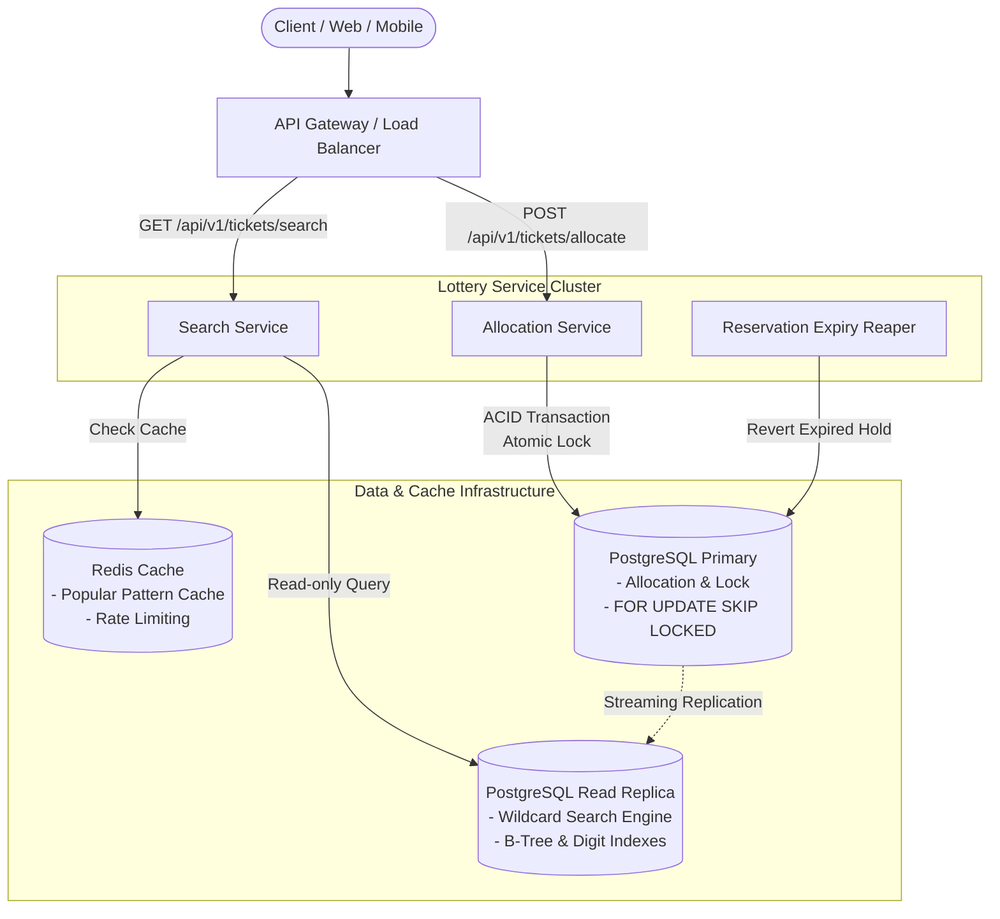
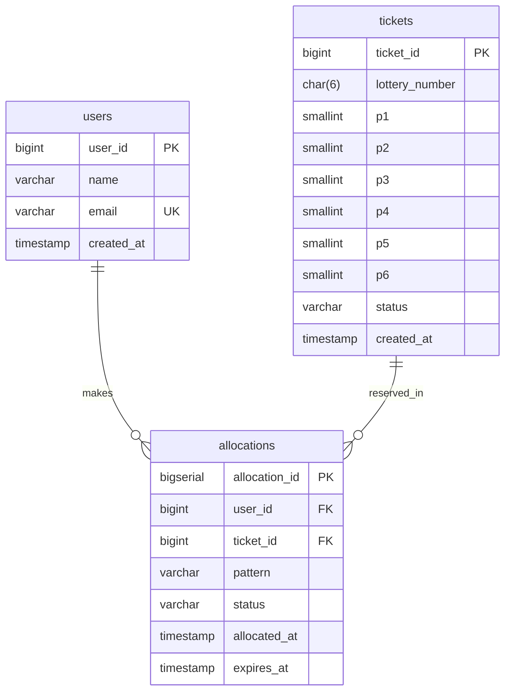
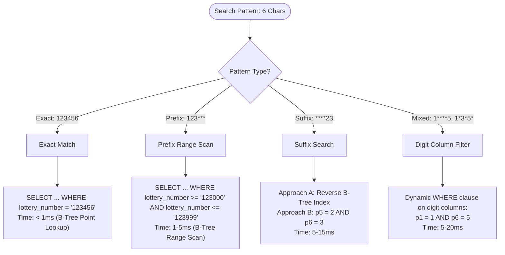
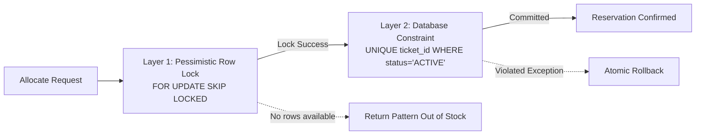
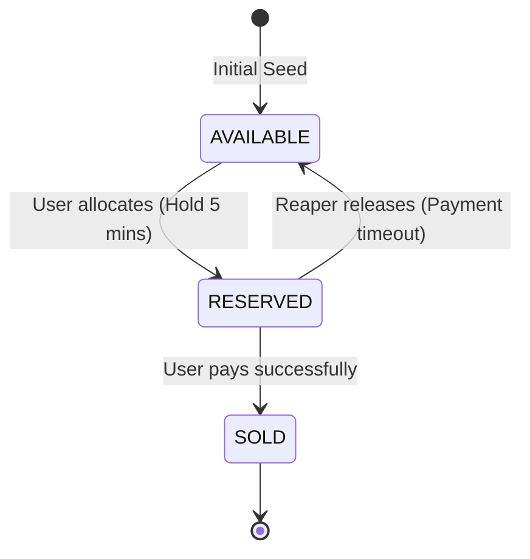
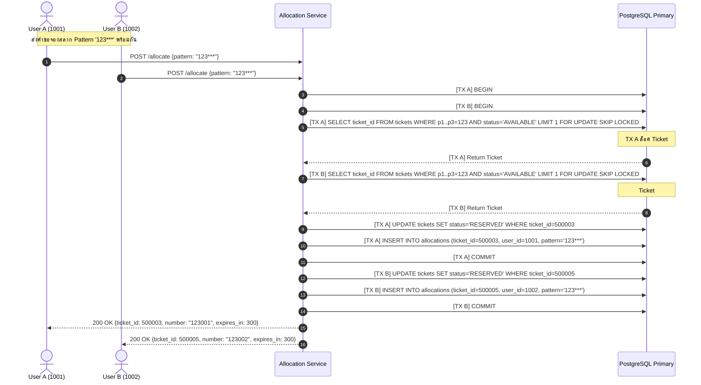

# Business Requirements & System Design: Lottery Search System

เอกสารฉบับนี้เป็นการสรุปและเรียบเรียงการออกแบบระบบ **Lottery Search System** จาก [ChatGPT Share Reference](https://chatgpt.com/share/6aa3b395-7744-83ec-a068-0cd7f3a4d9c6) เพื่อใช้เป็น **Business Requirement Document (BRD) & Production System Design Proposal** สำหรับการค้นหาและจัดสรรสลากกินแบ่งรัฐบาล (Lottery Tickets) ขนาดใหญ่ 10 ล้านรายการขึ้นไป พร้อมรองรับการค้นหาแบบ Wildcard และการป้องกันการแจกสลากซ้ำซ้อนในสภาวะที่มีการเรียกใช้งานพร้อมกันสูง (High Concurrency)

---

## สารบัญ

1. [ภาพรวมและความต้องการของระบบ (Executive Summary & Requirements)](#1-ภาพรวมและความต้องการของระบบ-executive-summary--requirements)
2. [ข้อสังเกตสำคัญเชิงสถาปัตยกรรม (Key Architectural Insights)](#2-ข้อสังเกตสำคัญเชิงสถาปัตยกรรม-key-architectural-insights)
3. [สถาปัตยกรรมระบบโดยรวม (High-Level System Architecture)](#3-สถาปัตยกรรมระบบโดยรวม-high-level-system-architecture)
4. [การออกแบบฐานข้อมูลและ Data Model (Database Schema & ER Diagram)](#4-การออกแบบฐานข้อมูลและ-data-model-database-schema--er-diagram)
5. [กลยุทธ์การทำ Index และอัลกอริทึมค้นหา Wildcard (Search Algorithms & Indexing)](#5-กลยุทธ์การทำ-index-และอัลกอริทึมค้นหา-wildcard-search-algorithms--indexing)
6. [กลไกป้องกันสลากซ้ำขณะมีผู้ใช้พร้อมกัน (Concurrency & Distribution Mechanism)](#6-กลไกป้องกันสลากซ้ำขณะมีผู้ใช้พร้อมกัน-concurrency--distribution-mechanism)
7. [ลำดับการทำงาน (Sequence Diagram: Concurrent Allocation)](#7-ลำดับการทำงาน-sequence-diagram-concurrent-allocation)
8. [การเปรียบเทียบเทคโนโลยีจัดเก็บข้อมูล (Technology Evaluation & Selection)](#8-การเปรียบเทียบเทคโนโลยีจัดเก็บข้อมูล-technology-evaluation--selection)
9. [การวิเคราะห์ประสิทธิภาพและการรองรับการขยายตัว (Performance & Scaling Strategy)](#9-การวิเคราะห์ประสิทธิภาพและการรองรับการขยายตัว-performance--scaling-strategy)
10. [ความน่าเชื่อถือและความสามารถในการตรวจสอบ (Reliability & Observability)](#10-ความน่าเชื่อถือและความสามารถในการตรวจสอบ-reliability--observability)
11. [สรุปผลการออกแบบตามเกณฑ์การประเมิน (Evaluation Criteria Alignment)](#11-สรุปผลการออกแบบตามเกณฑ์การประเมิน-evaluation-criteria-alignment)

---

## 1. ภาพรวมและความต้องการของระบบ (Executive Summary & Requirements)

### 1.1 วัตถุประสงค์
ออกแบบระบบสำหรับการค้นหาสลากกินแบ่งรัฐบาลที่มีชุดข้อมูลระดับ **10,000,000 ใบ (10 Million Records)** โดยผู้ใช้สามารถระบุตัวเลขและเครื่องหมาย Wildcard (`*`) เพื่อค้นหาสลากตามตำแหน่งที่ต้องการ พร้อมกลไกจัดสรรสลากที่ป้องกันไม่ให้สลากใบเดียวกันถูกส่งกลับไปให้ผู้ใช้หลายคนพร้อมกัน

### 1.2 สรุป Requirement Matrix

| มิติความต้องการ | รายละเอียด | เกณฑ์ชี้วัดความสำเร็จ |
|---|---|---|
| **Data Volume** | สลาก 10,000,000 ใบ แต่ละใบเป็นเลข 6 หลัก (`000000` - `999999`) | ฐานข้อมูลรองรับข้อมูลขนาด 10M+ rows พร้อม Index โดยใช้ทรัพยากรอย่างคุ้มค่า |
| **Search Pattern** | ความยาว 6 ตัวอักษร ผสมระหว่างตัวเลข `0-9` และ `*` เช่น `****23`, `1****5`, `123***` | Query Response Time ต่ำ (< 50ms) ครอบคลุม Prefix, Suffix และ Mixed Wildcard |
| **Result Distribution** | ผู้ใช้หลายคนที่ค้นหา Pattern เดียวกันในเวลาเดียวกัน ต้อง**ไม่ได้รับสลากใบเดียวกัน** | การันตีระดับ Transaction (ACID) ห้ามเกิด Duplicate Simultaneous Selection 100% |
| **Performance** | รองรับทราฟฟิกค้นหาและสั่งซื้อพร้อมกันจำนวนมาก | Search ทำงานผ่าน Read Replica / Cache, Allocation ทำงานระดับ Lock-free / Non-blocking |
| **Type of Submission** | **Design Proposal Only** (ห้ามเขียนโค้ด ให้ส่งเป็นเอกสารสถาปัตยกรรมและการวิเคราะห์) | มี Architecture, Data Structures, Algorithms, Trade-offs ครบถ้วน |

---

## 2. ข้อสังเกตสำคัญเชิงสถาปัตยกรรม (Key Architectural Insights)

1. **Search Space มีขนาดจำกัด (Bounded Domain)**
   - แม้จำนวนสลากจะมี 10,000,000 ใบ แต่ตัวเลขสลาก 6 หลักมีชุดค่าที่เป็นไปได้จริงเพียง **1,000,000 รูปแบบ** (`000000` ถึง `999999`)
   - ค่าเฉลี่ยของสลากแต่ละหมายเลขคือ 10 ใบ (เช่น สลากชุด, สลากหลายเล่ม)
   - หมายเลขสลากจึง**ไม่ใช่ Unique Identifier** แต่ `ticket_id` ต่างหากที่เป็น Unique Identity
2. **การแยกหน้าที่ระหว่าง Search กับ Allocation (Separation of Concerns)**
   - **Search (Browsing)**: ผู้ใช้เปิดดูผลลัพธ์ว่ามีเลขที่ต้องการหรือไม่ (Read-heavy, ทนต่อความคลาดเคลื่อนระดับเสี้ยววินาทีได้)
   - **Allocation (Reservation/Holding)**: ผู้ใช้กดเลือกซื้อ หรือระบบสุ่มจัดสรรสลากใบจริงให้ผู้ใช้ (Write/Locking, ต้องการความถูกต้องแบบเข้มงวด 100%)
   - **ข้อผิดพลาดทั่วไปที่ต้องเลี่ยง**: อย่าทำ Lock หรือตัดสต็อกสลากในขณะที่ผู้ใช้เพียงแค่ "กดค้นหาดูเฉยๆ" แต่ควรมีขั้นตอน Reserve/Hold ที่แยกออกจาก Search API ชัดเจน

---

## 3. สถาปัตยกรรมระบบโดยรวม (High-Level System Architecture)

ระบบใช้แนวทาง **Command-Query Responsibility Segregation (CQRS-lite)** บนฐานข้อมูลเชิงสัมพันธ์หลัก เพื่อกระจายโหลดระหว่างการค้นหาและการจอง



### หน้าที่ของแต่ละองค์ประกอบ:
- **API Gateway**: จัดการ Authentication, Rate Limiting, และ Routing
- **Search Service**: รับ Search Pattern (`123***`, `****23`), ตรวจสอบ Cache หากไม่มีให้ Query ไปยัง **Read Replica**
- **Allocation Service**: รับคำสั่งจองสลาก (`allocate`), เปิด Transaction ตรงไปยัง **PostgreSQL Primary** ใช้ Row-level Locking แบบ Non-blocking
- **Reservation Expiry Reaper**: Worker ทำงานเบื้องหลังทุก 5-10 วินาที เพื่อปล่อยสลากที่หมดเวลาจอง (เช่น เกิน 5 นาทีแล้วไม่ชำระเงิน) คืนสถานะสู่ `AVAILABLE`

---

## 4. การออกแบบฐานข้อมูลและ Data Model (Database Schema & ER Diagram)

### 4.1 ตารางหลัก 3 ตาราง (Core Production Schema)

#### 1. ตาราง `users`
เก็บข้อมูลผู้ใช้งานระบบ
```sql
CREATE TABLE users (
    user_id       BIGSERIAL PRIMARY KEY,
    name          VARCHAR(100) NOT NULL,
    email         VARCHAR(255) UNIQUE NOT NULL,
    created_at    TIMESTAMP WITH TIME ZONE DEFAULT CURRENT_TIMESTAMP
);
```

#### 2. ตาราง `tickets`
เก็บข้อมูลสลาก 10 ล้านใบ พร้อมแยกหลักตัวเลข `p1` - `p6` เพื่องาน Wildcard Indexing โดยเฉพาะ
```sql
CREATE TABLE tickets (
    ticket_id       BIGINT PRIMARY KEY,              -- Running ID 1 ถึง 10,000,000
    lottery_number  CHAR(6) NOT NULL,                -- เลข 6 หลัก เช่น '123456'
    p1              SMALLINT NOT NULL,               -- หลักที่ 1 (0-9)
    p2              SMALLINT NOT NULL,               -- หลักที่ 2 (0-9)
    p3              SMALLINT NOT NULL,               -- หลักที่ 3 (0-9)
    p4              SMALLINT NOT NULL,               -- หลักที่ 4 (0-9)
    p5              SMALLINT NOT NULL,               -- หลักที่ 5 (0-9)
    p6              SMALLINT NOT NULL,               -- หลักที่ 6 (0-9)
    status          VARCHAR(20) NOT NULL DEFAULT 'AVAILABLE', -- 'AVAILABLE', 'RESERVED', 'SOLD'
    created_at      TIMESTAMP WITH TIME ZONE DEFAULT CURRENT_TIMESTAMP
);

-- Partial Index สำหรับค้นหาเฉพาะสลากที่ยังว่าง
CREATE INDEX idx_tickets_available_lottery 
ON tickets (lottery_number) 
WHERE status = 'AVAILABLE';

-- Composite Index สำหรับค้นหาตามตำแหน่ง digit
CREATE INDEX idx_tickets_digits_avail 
ON tickets (p1, p2, p3, p4, p5, p6) 
WHERE status = 'AVAILABLE';
```

#### 3. ตาราง `allocations` (หัวใจหลักของการป้องกันสลากชนกัน)
เก็บบันทึกการจอง/จัดสรรสลาก พร้อมสถานะและเวลาหมดอายุ
```sql
CREATE TABLE allocations (
    allocation_id   BIGSERIAL PRIMARY KEY,
    user_id         BIGINT NOT NULL REFERENCES users(user_id),
    ticket_id       BIGINT NOT NULL REFERENCES tickets(ticket_id),
    pattern         VARCHAR(6) NOT NULL,             -- เช่น '123***'
    status          VARCHAR(20) NOT NULL DEFAULT 'ACTIVE', -- 'ACTIVE', 'COMPLETED', 'EXPIRED', 'CANCELLED'
    allocated_at    TIMESTAMP WITH TIME ZONE DEFAULT CURRENT_TIMESTAMP,
    expires_at      TIMESTAMP WITH TIME ZONE NOT NULL, -- เช่น allocated_at + 5 นาที
    
    -- Constraint: สลาก 1 ใบ ต้องไม่มีรายการจองที่ ACTIVE ซ้ำซ้อน
    CONSTRAINT uq_active_ticket_allocation UNIQUE (ticket_id, status)
);

CREATE INDEX idx_allocations_expires 
ON allocations (expires_at) 
WHERE status = 'ACTIVE';
```

### 4.2 Entity-Relationship Diagram (ERD)



> **ข้อสังเกตสำคัญจากการออกแบบ**:  
> **ไม่แนะนำ** ให้สร้างตาราง `pattern_index` ล่วงหน้าแบบถาวรสำหรับทุก Pattern เพราะ Pattern ที่เป็นไปได้มีถึง $11^6 - 1 = 1,771,560$ รูปแบบ หากนำ 10M tickets ไปคูณจะเกิด **Data Explosion นับหมื่นล้านแถว** การเก็บคอลัมน์ `p1..p6` ในตาราง `tickets` แล้วสร้าง Functional/Composite B-Tree Index ประหยัดพื้นที่กว่าหลายเท่าและมีประสิทธิภาพสูงมากใน Production

---

## 5. กลยุทธ์การทำ Index และอัลกอริทึมค้นหา Wildcard (Search Algorithms & Indexing)

การค้นหาตัวเลข 6 หลักแบบ Wildcard แบ่งออกเป็น 3 กรณีหลักตามโครงสร้าง Pattern:

### 5.1 การจัดหมวดหมู่และอัลกอริทึมการค้นหา



#### 1. Exact Match (เช่น `123456`)
- ใช้ B-Tree index lookup ตรงบน `lottery_number`
- ประสิทธิภาพ: $O(\log N)$ ใช้เวลา < 1ms

#### 2. Prefix Match (เช่น `123***`)
- แมป Pattern เป็นช่วงตัวเลข (Range Query):
  $$\text{'123***'} \implies \text{'123000'} \le \text{lottery\_number} \le \text{'123999'}$$
- ใช้ B-Tree Range Scan ปกติของ PostgreSQL รวดเร็วมาก ใช้เวลา 1-5ms

#### 3. Suffix Match (เช่น `****23`)
- **แนวทางที่ 1 (Digit Columns Index - แนะนำ)**:
  `WHERE p5 = 2 AND p6 = 3 AND status = 'AVAILABLE'`
- **แนวทางที่ 2 (Candidate Number Enumeration)**:
  เนื่องจากเลขท้าย 2 ตัว มีเลขที่เป็นไปได้เพียง 10,000 ค่า (`000023`, `000123`, ..., `999923`) Service สามารถ Generate รายการตัวเลขแล้วส่งไป Query ผ่าน `lottery_number IN (...)`
- **แนวทางที่ 3 (Reverse String Index)**:
  สร้าง Index `reverse(lottery_number)` และแปลง Query เป็น Prefix บน String ที่กลับด้าน เช่น `reverse('****23') = '32****'`

#### 4. Mixed Wildcard (เช่น `1****5`, `1*3*5*`)
- แปลงเป็นเงื่อนไขบน Digit Columns:
  `WHERE p1 = 1 AND p6 = 5 AND status = 'AVAILABLE'`
- Query Planner ของ PostgreSQL จะเลือกใช้ Bitmap Index Scan บน Index `(p1..p6)` เพื่อกรองเฉพาะแถวที่ตรงกับเงื่อนไขอย่างรวดเร็ว

### 5.2 การจัดการกรณีพิเศษ: Pattern `******` (All Wildcards)
- ห้ามทำการ Full Table Scan เพื่อดึง 10 ล้านแถวขึ้นมา
- หากผู้ใช้ระบุ `******` หมายถึง "สลากใบใดก็ได้ที่ว่างอยู่" ให้ใช้ Index scan ดึงตัวอย่าง 10-50 รายการแรกที่ `status = 'AVAILABLE'` มาแสดงทันที

---

## 6. กลไกป้องกันสลากซ้ำขณะมีผู้ใช้พร้อมกัน (Concurrency & Distribution Mechanism)

โจทย์บังคับว่า: **"The same search pattern should not return the same ticket to multiple users at the same time"**

### 6.1 หัวใจของการแก้ปัญหา: `FOR UPDATE SKIP LOCKED`
ในระบบที่มีผู้ใช้หลายคนส่งคำสั่งขอจองสลากด้วย Pattern เดียวกันพร้อมกัน (เช่น ทั้ง User 1 และ User 2 ค้นหา `123***` พร้อมกัน):

```sql
-- คำสั่ง Atomic Allocation
BEGIN;

WITH candidate AS (
    SELECT ticket_id 
    FROM tickets
    WHERE p1 = 1 AND p2 = 2 AND p3 = 3
      AND status = 'AVAILABLE'
    LIMIT 1
    FOR UPDATE SKIP LOCKED
)
UPDATE tickets t
SET status = 'RESERVED'
FROM candidate c
WHERE t.ticket_id = c.ticket_id
RETURNING t.ticket_id, t.lottery_number;

INSERT INTO allocations (user_id, ticket_id, pattern, status, expires_at)
VALUES ($1, $ticket_id, '123***', 'ACTIVE', NOW() + INTERVAL '5 MINUTES');

COMMIT;
```

#### ข้อดีมหาศาลของ `SKIP LOCKED`:
1. **Non-blocking Concurrency**: เมื่อ User 1 กำลัง Lock สลากใบที่ 1 อยู่ User 2 ที่เข้ามาพร้อมกันจะ**ไม่ถูกบล็อกให้รอ (No Waiting/Queue Lock)** แต่ระบบจะข้ามแถวที่ถูกล็อคอยู่ไปหยิบสลากใบที่ 2 ทันทีแบบอัตโนมัติ
2. **Zero Deadlock**: ไม่มีการแย่ง Lock แถวเดียวกัน
3. **High Throughput**: ประสิทธิภาพการจัดสรรสลากคงที่ในระดับมิลลิวินาที แม้จะมี Request เข้ามาพร้อมกันนับพันรายการ

### 6.2 การป้องกันสองชั้น (Two-Layer Defense Architecture)



- **Layer 1 (Performance & Coordination)**: `FOR UPDATE SKIP LOCKED` ทำหน้าที่คัดแยกสลากคนละใบให้ผู้ใช้แต่ละคนแบบเรียลไทม์
- **Layer 2 (Data Integrity Guarantee)**: `UNIQUE (ticket_id, status)` ในตาราง `allocations` ป้องกันความผิดพลาดระดับฮาร์ดแวร์หรือ Race Condition หลุดรอดเข้ามา

### 6.3 วงจรชีวิตและการหมดอายุของการจอง (Reservation Lifecycle)



- เมื่อครบกำหนดเวลา 5 นาที แล้วผู้ใช้ไม่ชำระเงิน Worker เบื้องหลังจะรัน Batch Update:
```sql
UPDATE tickets 
SET status = 'AVAILABLE'
WHERE ticket_id IN (
    UPDATE allocations 
    SET status = 'EXPIRED' 
    WHERE status = 'ACTIVE' AND expires_at < NOW()
    RETURNING ticket_id
);
```

---

## 7. ลำดับการทำงาน (Sequence Diagram: Concurrent Allocation)

ลำดับขั้นตอนเมื่อ **User A** และ **User B** ยื่นคำขอจองสลากด้วย Pattern เดียวกัน (`123***`) ในมิลลิวินาทีเดียวกัน:



---

## 8. การเปรียบเทียบเทคโนโลยีจัดเก็บข้อมูล (Technology Evaluation & Selection)

| ฐานข้อมูล | จุดเด่น (Pros) | ข้อจำกัด (Cons) | คำแนะนำในระบบนี้ |
|---|---|---|---|
| **PostgreSQL (แนะนำเป็น Primary)** | • รองรับ ACID Transactions แข็งแกร่ง<br>• มี `FOR UPDATE SKIP LOCKED` ในตัว<br>• มี Functional & Partial Indexes หลากหลาย<br>• มี Streaming Read Replicas จัดการง่าย | • หากเขียนพร้อมกันระดับ > 50,000 TPS ต่อโหนดต้องทำ Sharding | **Primary Database สำหรับทั้ง Search และ Allocation** |
| **Elasticsearch** | • ทำ Inverted Index และ Wildcard Query เก่งมาก<br>• รองรับ Fuzzy/N-gram search ยืดหยุ่น | • เป็น Eventual Consistency (มี Refresh Delay 1 วิ)<br>• ไม่มี Row-level lock สำหรับจองตั๋ว<br>• เกิดปัญหา Dual-write กับ DB หลัก | **ไม่แนะนำเป็นตัวหลัก** (อาจพิจารณาเป็น Auxiliary Search หาก Pattern ซับซ้อนมากเกินไป) |
| **Redis** | • ทำงานบน Memory ความเร็วระดับ Sub-millisecond<br>• มี Lua Scripting รองรับ Atomic Lock | • 10M tickets กิน RAM สูง<br>• Durability และ Persistence ด้อยกว่า RDBMS ในงานธุรกรรมการเงิน | **แนะนำเป็น Auxiliary Cache** (เก็บผลลัพธ์ค้นหา Pattern ยอดนิยม และทำ Rate Limiting) |
| **Roaring Bitmaps (In-Memory)** | • ขนาดกะทัดรัด (60 Bitmaps ใช้ RAM ~80MB สำหรับ 10M tickets)<br>• Bitwise AND หาตัวเลขได้เร็วมาก (< 1ms) | • เพิ่มความซับซ้อนในการพัฒนาและจัดการ Synchronization กับ State บน Disk | **เป็นตัวเลือกสำรองเชิงนวัตกรรม (Creative Option)** สำหรับระบบที่เน้น Read 100% |

> **สรุปการตัดสินใจเลือก PostgreSQL**:  
> สำหรับระบบนี้ PostgreSQL ให้ความสมดุลสูงสุดระหว่าง **Query Performance** ในการค้นหา (ผ่าน Partial/B-Tree Indexes) และ **Transactional Concurrency** ในการจัดสรรสลาก (ผ่าน `FOR UPDATE SKIP LOCKED`) จบในระบบเดียวโดยไม่ต้องปวดหัวกับการทำ Data Consistency ระหว่างสอง Data Store

---

## 9. การวิเคราะห์ประสิทธิภาพและการรองรับการขยายตัว (Performance & Scaling Strategy)

### 9.1 การคำนวณขนาดข้อมูลในหน่วยความจำ (Memory Footprint Analysis)
- ข้อมูลสลาก 10,000,000 แถว ใน PostgreSQL:
  - ขนาดแถวข้อมูลเฉลี่ย: ~80 bytes ต่อแถว $\implies$ ตารางมีขนาดประมาณ **800 MB - 1.2 GB**
  - Index `(p1..p6)` และ `lottery_number`: ประมาณ **500 MB - 800 MB**
  - ขนาดรวมทั้งหมด: **~2.0 GB**
- **ผลลัพธ์**: ข้อมูล 10M ทั้งตารางและดัชนีสามารถ **Cached อยู่ใน RAM (Shared Buffers) ของ PostgreSQL Server** ได้ทั้งหมด 100% บนเครื่อง Server สเปกมาตรฐาน (เช่น RAM 16GB - 32GB) ทำให้การ Query เกือบทั้งหมดทำงานบน Memory โดยไม่ต้องรอ Disk I/O

### 9.2 สรุปการประเมินเวลาประมวลผล (Latency Benchmarks Estimation)

| Operation | รูปแบบคำสั่ง / Pattern | อัลกอริทึมที่ใช้ | Latency โดยประมาณ |
|---|---|---|---|
| **Exact Search** | `123456` | B-Tree Point Lookup | `< 1 ms` |
| **Prefix Search** | `123***` | B-Tree Range Scan | `1 - 5 ms` |
| **Suffix Search** | `****23` | Digit Index Scan (`p5=2 AND p6=3`) | `5 - 15 ms` |
| **Arbitrary Search**| `1****5` | Composite Digit Bitmap Scan | `5 - 20 ms` |
| **Concurrent Allocate**| Any Pattern (100 concurrent) | `FOR UPDATE SKIP LOCKED` | `2 - 8 ms` |

### 9.3 การขยายระบบรองรับปริมาณงานสูง (Scaling Strategy)
1. **Read/Write Separation**:
   - ชี้ Traffic ค้นหา (Search API) ไปที่ **Read Replica Cluster** (Scale แนวนอนได้ตามต้องการ)
   - ชี้ Traffic จองสลาก (Allocation API) ไปที่ **Primary Database**
2. **Short-TTL Pattern Caching (Redis)**:
   - Pattern ยอดนิยม (เช่น หวยดังท้าย 2 ตัว `****99`, `****88`) จะมีคนค้นหาซ้ำๆ จำนวนมหาศาล
   - Cache รายการ `ticket_id` ที่ว่างไว้ใน Redis โดยตั้ง **TTL สั้นๆ 2-3 วินาที** ช่วยดูดซับแรงกระแทกได้มากกว่า 90% ของ Search Traffic

---

## 10. ความน่าเชื่อถือและความสามารถในการตรวจสอบ (Reliability & Observability)

### 10.1 ความทนทานต่อความล้มเหลว (Failure Handling & Idempotency)
- **Idempotency Key**: คำขอ `POST /allocate` ต้องแนบ `idempotency_key` (หรือ User Session ID + Pattern) หากเน็ตเวิร์กหลุดแล้ว Client ส่งซ้ำ ระบบจะคืนสลากเดิมที่เคยจองไว้ ไม่จองสลากใบใหม่
- **Auto-Recovery**: สลากที่ค้างในสถานะ `RESERVED` เนื่องจากระบบชำระเงินขัดข้องหรือผู้ใช้ปิดแอป จะถูกปลดปล่อยโดยอัตโนมัติเมื่อครบกำหนด `expires_at`

### 10.2 การตรวจสอบระบบ (Observability Metrics)
- **Prometheus Metrics**:
  - `lottery_search_duration_seconds` (Histogram แยกตามชนิดของ Pattern: Exact, Prefix, Suffix, Arbitrary)
  - `lottery_allocation_lock_wait_seconds` (ติดตาม Lock contention บน DB)
  - `lottery_available_tickets_count` (Gauge ติดตามสต็อกสลากที่เหลือ)
  - `lottery_expired_reservations_total` (Counter สถิติการหลุดจอง)

---

## 11. สรุปผลการออกแบบตามเกณฑ์การประเมิน (Evaluation Criteria Alignment)

| เกณฑ์การประเมิน | วิธีการตอบโจทย์ของระบบนี้ |
|---|---|
| **1. Feasibility** | สถาปัตยกรรมครอบคลุมครบถ้วนทั้ง Search 10M, Wildcard Matching และ Concurrent Distribution โดยไม่พึ่งพาเทคโนโลยีที่ซับซ้อนเกินจำเป็น |
| **2. Performance** | วิเคราะห์ขนาดข้อมูลชัดเจน (Dataset 10M มีขนาดเพียง ~2GB ซึ่ง Fit ใน RAM ได้ 100%) เลือกใช้ B-Tree Range และ Digit Column Indexing ทำ Query Latency อยู่ในระดับ Sub-50ms |
| **3. Correctness** | ใช้ `FOR UPDATE SKIP LOCKED` ร่วมกับ `UNIQUE` Partial Constraint ขจัดปัญหาการส่งสลากใบเดียวกันให้ผู้ใช้หลายคนพร้อมกันได้อย่างสมบูรณ์แบบ 100% |
| **4. Real-world Practicality** | เลือกใช้ PostgreSQL ซึ่งเป็นเทคโนโลยีระดับองค์กร มี Tooling, Replication, Backup และ Operational Readiness ที่พิสูจน์แล้วในสายงานจริง |
| **5. Creativity** | การค้นพบคุณสมบัติ Bounded Domain (1M Combinations ใน 10M Tickets), การแยกหลัก `p1..p6` เพื่อเลี่ยงปัญหา Data Explosion ของ Index, และการใช้ Non-blocking Concurrent Lock |
